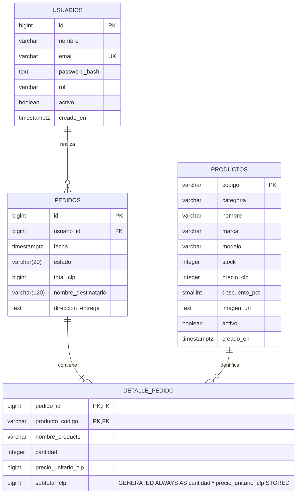

# AudioMax / Sonido Vivo — Backend

Backend REST para el proyecto académico **Sonido Vivo (AudioMax)** de DSY1104, Desarrollo Fullstack II, 2026. El alcance cubre catálogo, cuentas de cliente, autenticación JWT, compras con control transaccional de stock, historial propio y herramientas administrativas de productos y pedidos.

**Equipo:** Los Androides — Cristóbal Aguilera, Franco Fuentealba Arce y Aaron Hernández.
**Sección:** 005D
**Frontend:** [FullstackReact](https://github.com/FrancoFuentealba/FullstackReact).
**Repositorio backend:** [sonidovivo-backend](https://github.com/aaronhernandez2006/sonidovivo-backend).
**Enlace Drive:** [https://drive.google.com/drive/folders/1_5g77gu0gb3D_mR7W476sDRTItrswFoy?usp=drive_link]

## Arquitectura y decisiones

Se eligió **Node.js con Express** para reutilizar JavaScript en cliente y servidor y conservar una API REST pequeña que pueda integrarse con el frontend React existente. El backend se ejecuta como proceso persistente en una instancia **AWS EC2**. La persistencia se aloja en **PostgreSQL administrado por AWS RDS**; no se usa memoria del proceso ni almacenamiento del navegador para representar el estado persistente del catálogo, usuarios y pedidos.

`src/server.js` configura Express, Helmet, CORS, JSON, documentación y montaje de rutas. Los módulos `src/routes/` reciben HTTP, validan la entrada, consultan servicios de datos y forman las respuestas. `src/config/db.js` administra el pool de PostgreSQL. `src/routes/auth.js` centraliza registro, emisión/verificación JWT y autorización por rol; `src/routes/pedidos.js` implementa compra e historial; `src/routes/productos.js` implementa catálogo y CRUD. La lógica de la compra y la actualización de inventario se ejecutan en una transacción SQL.

### Modelo de datos

El modelo utiliza cuatro entidades principales: `usuarios`, `productos`, `pedidos` y `detalle_pedido`. Los pedidos pertenecen a un usuario; cada pedido contiene líneas de detalle que enlazan el pedido con un producto. El detalle conserva el nombre y el precio unitario aplicado en la compra, para que el historial represente la operación aunque el catálogo cambie después. El total y los descuentos se calculan en el backend a partir del precio y el descuento vigentes en la base, no de valores enviados por el cliente.



Las restricciones de negocio conocidas incluyen email normalizado y único, rol `cliente` o `admin`, stock no negativo, descuento entre 0 y 100, cantidad de línea mayor que cero y precio unitario no negativo. `subtotal_clp` lo calcula PostgreSQL como columna generada almacenada. El borrado administrativo de un producto es lógico (`activo=false`) para conservar referencias históricas. Durante el checkout la API rechaza códigos repetidos en una misma solicitud, valida cantidades, bloquea filas de producto para evitar sobreventa y revierte la transacción si algún producto no está disponible o no tiene stock suficiente.

**Confirmado contra RDS el 18-11-2026:** `pedidos.id` es `bigint`; `usuario_id` es `bigint` y referencia `usuarios(id)` con `ON DELETE RESTRICT`; `fecha` es `timestamptz` con `DEFAULT now()`; `estado` es `varchar(20)` limitado a `preparacion`, `despachado` o `entregado`; `total_clp` es `bigint` no negativo. Existe un índice por `(usuario_id, fecha DESC)`. En `detalle_pedido`, la clave primaria compuesta es `(pedido_id, producto_codigo)` y ambas columnas también son llaves foráneas. `pedido_id` referencia `pedidos(id)` con `ON DELETE CASCADE`; `producto_codigo` referencia `productos(codigo)` con `ON DELETE RESTRICT`. `subtotal_clp` es `bigint GENERATED ALWAYS ... STORED`. Estos campos y relaciones ya están reflejados en el ERD. [https://drive.google.com/drive/folders/1_5g77gu0gb3D_mR7W476sDRTItrswFoy?]

El catálogo inicial de diez productos se cargó en RDS. La carga fue manual y aún no hay un script de semillas versionado. El esquema también fue creado en RDS durante el trabajo; falta versionar una migración reproducible sin datos secretos.

## Contratos REST y pantallas

La especificación viva sigue el formato OpenAPI, un contrato estándar para describir rutas, entradas y respuestas [3]. Está versionada en [`src/openapi.json`](src/openapi.json). Al iniciar el servidor, el middleware `swagger-ui-express` presenta el contrato como interfaz interactiva en **`/api/docs`** [4] y el JSON descargable queda en **`/api/openapi.json`**. Swagger UI documenta ejemplos ficticios, respuestas y `Bearer JWT`; los ejemplos no son cuentas ni tokens reales. Que una ruta aparezca en el contrato no significa que esté disponible en el servidor desplegado hasta instalar los cambios y reiniciar el proceso.

Rutas actualmente implementadas en el código:

| Método y ruta | Acceso | Uso en la interfaz y resultado |
|---|---|---|
| `GET /api/health` | Público | Comprobar disponibilidad del backend. |
| `GET /api/db-check` | Público en la implementación actual | Diagnóstico básico de conexión PostgreSQL; revisar su exposición antes de producción. |
| `GET /api/productos` | Público | Catálogo, detalle, búsqueda, categorías y ofertas; devuelve solo productos activos. |
| `POST /api/productos` | Admin | Crear producto; `201`, `400`, `401`, `403`, `409`. |
| `PUT /api/productos/{codigo}` | Admin | Actualizar campos de producto; `200`, `400`, `401`, `403`, `404`. |
| `DELETE /api/productos/{codigo}` | Admin | Retirar producto lógicamente; `200`, `401`, `403`, `404`. |
| `POST /api/auth/register` | Público | Registrar cliente. El rol inicial se asigna en servidor. Devuelve `201`; entrada inválida `400`; duplicado `409`. |
| `POST /api/auth/login` | Público | Verifica bcrypt y emite JWT; devuelve `200`, credenciales incorrectas `401`. |
| `GET /api/auth/me` | JWT válido | Obtener el perfil del usuario autenticado. |
| `POST /api/pedidos` | JWT válido | Checkout; el cliente envía dirección y códigos/cantidades. La API calcula precios/total y actualiza stock; devuelve `201` o `409` si no hay disponibilidad. |
| `GET /api/pedidos/mios` | JWT válido | Pantalla “Mis pedidos”; el usuario se deriva del token, no de un id del navegador. |
| `GET /api/pedidos/admin` | Admin | Panel de administración de pedidos. |
| `PATCH /api/pedidos/{id}/estado` | Admin | Cambiar el estado a `preparacion`, `despachado` o `entregado`. |

Los recursos protegidos devuelven `401` si falta el token o no es válido y `403` cuando el usuario autenticado no tiene rol suficiente. Las respuestas nunca incluyen `password_hash`. El checkout asigna el pedido al usuario del JWT, no acepta `usuario_id` del cliente. `GET /api/pedidos/mios` filtra por ese mismo usuario, lo que impide consultar pedidos de otra persona cambiando un identificador en la URL.

## Registro, sesión y seguridad

El registro normaliza el correo y asigna el rol `cliente` dentro del backend; no acepta que una persona se eleve a administradora mediante el formulario. El rol administrativo debe asignarse por un procedimiento controlado del equipo, directamente en la base con acceso restringido; aún no existe una ruta pública para cambiar roles.

Las contraseñas se guardan con `bcryptjs`, usando factor de costo 12 y un límite de 8 a 72 bytes UTF-8. bcrypt incorpora sal en su formato de hash. OWASP prefiere Argon2id para sistemas nuevos; cuando se mantiene bcrypt, recomienda factor de trabajo al menos 10 y respetar su límite de entrada de 72 bytes. Se eligió bcryptjs para esta implementación JavaScript existente y el factor 12 supera ese mínimo, aunque debe medirse el costo en la instancia de despliegue y reevaluarse Argon2id antes de un uso real [1].

El servidor emite JWT HS256 con `sub` (id de usuario), `iss` (`audiomax-api`), `aud` (`audiomax-frontend`) y expiración configurada por `JWT_EXPIRES_IN` (por defecto `1h`). El backend limita algoritmos aceptados a HS256 y valida firma, emisor, destinatario y vencimiento. El JWT no cifra su contenido: no se incluyen contraseñas ni hashes. El frontend guarda el token solo en memoria; al recargar, la persona debe iniciar sesión de nuevo. Cerrar sesión borra la copia en memoria, pero no revoca una copia ya emitida; el token sigue siendo válido hasta `exp`, salvo que la cuenta se desactive, porque el middleware consulta la cuenta activa en cada solicitud. OWASP recomienda HTTPS, comprobación de claims del JWT y autorización en cada endpoint protegido [2].

**Controles ya observables:** Helmet; CORS limitado a los orígenes configurados; consultas PostgreSQL parametrizadas; validación de entrada; control de rol en el backend; la propiedad de pedidos se deriva del JWT; `.env` está ignorado por Git. El archivo `.env.example` solo debe contener nombres y marcadores, nunca contraseñas reales, tokens ni claves utilizables.

**Pendientes antes de exponer el servicio a usuarios reales:** configurar y comprobar HTTPS extremo a extremo en EC2; cambiar la conexión TLS a RDS para verificar el certificado de AWS (la configuración actual usa `rejectUnauthorized: false`); añadir límites de intentos de login/registro y respuestas `429`; revisar si `GET /api/db-check` debe restringirse; y validar que los logs no capturen tokens o datos sensibles. OWASP requiere proteger credenciales y tokens en tránsito mediante HTTPS y controlar el acceso en cada endpoint [2]. CORS no sustituye la autorización.

## Diagramas de secuencia

Este diagrama representa el inicio de sesión y el uso posterior del token. El transporte de producción debe ser HTTPS; el servidor actual emite/valida el JWT y vuelve a consultar que la cuenta esté activa.

```mermaid
sequenceDiagram
    actor Cliente
    participant React
    participant API as Express API
    participant DB as PostgreSQL RDS
    Cliente->>React: correo y contraseña
    React->>API: POST /api/auth/login (HTTPS en despliegue)
    API->>DB: buscar usuario por correo
    DB-->>API: usuario, hash, rol y estado
    API->>API: bcrypt.compare; firmar JWT HS256
    API-->>React: 200 accessToken, Bearer, expiresIn, usuario
    React->>React: guardar token en memoria
    React->>API: GET /api/auth/me + Authorization: Bearer token
    API->>API: verificar HS256, exp, iss, aud y subject
    API->>DB: comprobar que el usuario existe y está activo
    DB-->>API: perfil permitido
    API-->>React: 200 perfil sin hash ni contraseña
```

El frontend y el backend están en repositorios separados. En el checkout React envía nombre de destinatario, dirección, códigos y cantidades. La API valida esos datos, lee precios/descuentos/stock de PostgreSQL bajo bloqueo, calcula el total, inserta pedido y líneas, descuenta stock y confirma todo en una transacción; si falla una condición, revierte y devuelve error.

## Instalación y configuración

Requisitos: Node.js compatible con Express 5 (Node 18 o superior), npm y acceso de red a una instancia PostgreSQL. En AWS, el grupo de seguridad de RDS debe aceptar conexiones desde el grupo de seguridad EC2 en el puerto PostgreSQL; no se debe abrir la base a todo Internet.

```bash
git clone https://github.com/aaronhernandez2006/sonidovivo-backend.git
cd sonidovivo-backend
npm ci
cp .env.example .env
nano .env
```

Completen el archivo local `.env` con `PORT`, `DB_HOST`, `DB_PORT`, `DB_NAME`, `DB_USER`, `DB_PASSWORD`, `JWT_SECRET`, `JWT_EXPIRES_IN` y `CORS_ORIGINS`. `CORS_ORIGINS` admite una lista de orígenes separados por coma, por ejemplo el origen local de Vite y el dominio desplegado. `JWT_SECRET` debe tener al menos 64 caracteres aleatorios. Generen el valor en la instancia, no lo publiquen ni lo peguen en el chat. `.env` está ignorado por Git; nunca hagan `git add .env`.

```bash
npm run dev       # desarrollo con reinicio al cambiar archivos
npm start         # ejecución normal
```

Al arrancar, abrir `http://localhost:3000/api/health`, `http://localhost:3000/api/db-check` y `http://localhost:3000/api/docs`. Para la prueba desde la computadora del equipo, usar el host y puerto de EC2 que corresponda. El backend debe estar ejecutándose y la política de red debe permitir el acceso. No publicar contraseñas en comandos, capturas, historial de shell o informes.

Para obtener una cuenta cliente, usar `POST /api/auth/register` y luego iniciar sesión. No hay endpoint de promoción a administrador; el rol inicial de registro siempre es `cliente`. Las cuentas administrativas deben provisionarse de forma controlada en RDS, sin compartir la clave ni incluirla en el repositorio.

## Avance y resultados comprobados

**Implementado:** conexión del backend con RDS PostgreSQL; catálogo inicial persistente; registro, login y perfil con JWT; compra con transacción y control de stock; historial propio; listado/cambio de estado de pedidos para admin; CRUD de productos con retiro lógico; frontend React conectado a las rutas principales.

**Probado según la ejecución comunicada por el equipo el 18 de noviembre de 2026:** registro/login/perfil; compra e historial; `npm run test:run` y `npm run build` del frontend; `node --check` del servidor y rutas; prueba de autorización que devolvió HTTP `403` para un cliente en `GET /api/pedidos/admin` y `POST /api/productos`, y eliminó la cuenta temporal al finalizar. Estos son resultados reportados desde la instancia del equipo, no una ejecución contra RDS realizada desde este repositorio documental.

**Pendiente de verificar luego de instalar estos cambios:** abrir `/api/docs` en EC2; descargar `/api/openapi.json`; probar con un JWT de cliente y un JWT admin sin usar credenciales reales en la documentación; comprobar el despliegue HTTPS, el alcance de CORS, el TLS de RDS y la restricción de red; completar la clave primaria exacta de `detalle_pedido`; incorporar DDL/migraciones y datos semilla reproducibles; agregar pruebas automatizadas para las rutas backend; y adjuntar el enlace directo del ERD en Drive con permisos de lectura para el docente.

## Referencias

[1]: https://cheatsheetseries.owasp.org/cheatsheets/Password_Storage_Cheat_Sheet.html "OWASP Password Storage Cheat Sheet"
[2]: https://cheatsheetseries.owasp.org/cheatsheets/REST_Security_Cheat_Sheet.html "OWASP REST Security Cheat Sheet"
[3]: https://spec.openapis.org/oas/v3.0.3 "OpenAPI Specification 3.0.3"
[4]: https://www.npmjs.com/package/swagger-ui-express "swagger-ui-express en npm"
